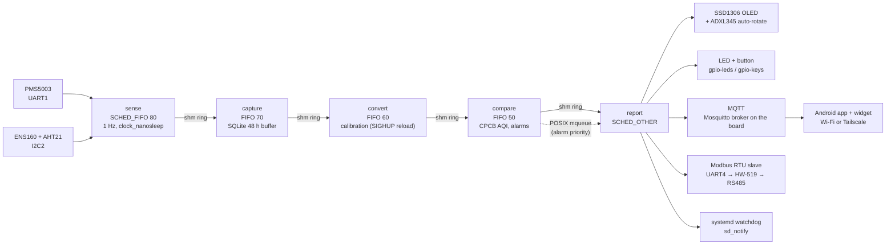

# BeagleBone Black Wireless — Real-Time Air-Quality Monitor

A multi-process, real-time air-quality monitor built on a BeagleBone Black Wireless (TI AM335x, 1 GHz Cortex-A8, 512 MB), covering the whole stack: **custom U-Boot → PREEMPT_RT kernel → own device-tree overlay → user-space drivers → a 5-stage real-time pipeline with IPC → display, MQTT (with an Android app) and Modbus RTU over RS485**.

It measures PM1.0 / PM2.5 / PM10, TVOC, eCO2, temperature and humidity once per second, computes the Indian CPCB AQI, keeps a 48 h offline buffer, and reports locally (OLED, LED, button) and remotely (MQTT, Modbus RTU, and an Android app that also works away from home over Tailscale). A self-test checks the whole board every day and sends the result to the app.

  

---

## Highlights

| | Result |
|---|---|
| **Real-time latency** (cyclictest, 300 000 cycles, under CPU + I/O + memory stress) | worst case **711 µs → 109 µs** with PREEMPT_RT (**6.5×**) |
| **Priority inversion demo** (`tools/pi_demo`) | 681 ms → 181 ms with priority inheritance (**3.8×**) |
| **Pipeline** (sensor → report, 5 processes) | wake-up jitter avg ~150 µs, stage-to-stage IPC ~150–240 µs, end-to-end ~0.4–2 ms |
| **Boot time** | 59.2 s → **47.2 s** (unused services removed); data on the MQTT broker 26 s after the display (was ~97 s) |
| **Restart recovery** | 24 h averages rebuilt from SQLite at start-up: 26 700 rows in 369 ms |
| **Fault handling** | a missing or failed sensor is reported as `--` / `null` / `0xFFFF` — never as 0 or "clean air"; a stalled ENS160 is reset automatically within 10 s |
| **Self-diagnosis** | ~40-check self-test (services, watchdogs, RTC, overlay, I2C scan, sensor error counters, network, MQTT, Modbus) runs 2 min and 15 min after power-on, then every 24 h; the summary is shown in the phone app |
| **Modbus RTU over RS485** | 25-register read, valid CRC every poll, 85–89 ms per poll at 9600 baud |

---

## Architecture



**Why five processes:** each stage has one job and its own real-time priority — the closer to the sensor, the higher the priority — so a slow consumer (display, network, SD card) can never delay sampling.

### IPC and synchronisation

| Mechanism | Used for |
|---|---|
| POSIX shared memory (`/aqm_shm`) | four ring buffers (64 samples each) between the stages |
| **Process-shared, robust, priority-inheritance mutex** | protects each ring; *robust* survives a stage crashing while holding it, *PI* prevents priority inversion between FIFO 80 and FIFO 50 |
| Unnamed process-shared semaphores | `items` / `spaces` counting: non-blocking push (drop + count if full), timed pop |
| POSIX message queue (`/aqm_alarm`) | alarms, delivered **highest priority first** (fault 10 > warning 5 > info 1) |
| Signals | `SIGINT`/`SIGTERM` clean stop of all stages, `SIGHUP` reloads calibration |
| pthread mutex (inside `report`) | Modbus server thread vs. sample updates |

### Real-time techniques
- `SCHED_FIFO` priority ladder 80 / 70 / 60 / 50, `mlockall()` (no page faults in the loop)
- `clock_nanosleep(TIMER_ABSTIME)` on an absolute deadline — no drift
- SQLite writes batched (10 rows per transaction, WAL) in a separate `SCHED_OTHER` thread
- AHT21 measurement split across ticks (read the previous result, start the next) so the 80 ms conversion never blocks the 1 Hz loop
- On PREEMPT_RT the I2C adapter lock is an rt_mutex, so the display stage is priority-boosted while it holds the bus

---

## Hardware

| Part | Interface | BeagleBone pins | Driver |
|---|---|---|---|
| Plantower **PMS5003** (PM1/2.5/10) | UART1 9600 8N1 | P9.24 TX, P9.26 RX, 5 V P9.7 | `common/src/pms5003.c` — frame resync, checksum, stale/fault detection |
| ScioSense **ENS160** (TVOC, eCO2) | I2C2 0x53 | P9.19 SCL, P9.20 SDA, 3.3 V P9.3 | `common/src/ens160.c` — validity states, T/RH compensation |
| ASAIR **AHT21** (temperature, RH) | I2C2 0x38 | (same module) | `common/src/aht21.c` — CRC-8, non-blocking split measurement |
| **SSD1306** 128×64 OLED | I2C2 0x3C | | `common/src/ssd1306.c` — 4 rotations, page-wise changed-only flush |
| **ADXL345** accelerometer | I2C2 0x1D | | `common/src/adxl345.c` + calibrated auto-rotate (`orient.c`) |
| Push button | gpio-keys (kernel) | P8.12 → GND | `/dev/input/event*` "aqm-keys", KEY_PROG1 |
| Alarm LED | gpio-leds (kernel) | P8.14 → 1 kΩ → LED | `/sys/class/leds/aqm:alarm` |
| **HW-519** RS485 (MAX485 + auto-direction) | UART4 9600 8N2 | P9.13 TX → TXD, RXD → 1 kΩ → P9.11, VCC 3.3 V | `common/src/modbus.c` |
| CP2102 USB-UART | serial console J1 | GND pin 1, TX pin 4, RX pin 5 | U-Boot / kernel console |

All I2C devices share I2C2 at **400 kHz**. eCO2 is the ENS160's *estimate* derived from VOCs, not an NDIR CO2 measurement.

---

## Board bring-up

### Boot chain
```
ROM → custom U-Boot 2022.04-aqm (eMMC) → PREEMPT_RT 6.12.111-bone-rt-r73 → BB-AQM-00A0 overlay → systemd → aqm.service
```

### Custom U-Boot
- Source: `beagleboard/u-boot`, branch `v2022.04-bbb.io-am335x-am57xx` (keeps `uEnv.txt` overlay support), `am335x_evm_defconfig` + [`bootloader/u-boot-aqm.config`](bootloader/u-boot-aqm.config): version tag `-aqm`, 2 s autoboot, project boot banner.
- Installed raw on the eMMC (MLO at 128 KiB, u-boot-dtb.img at 384 KiB). The SD card keeps the stock U-Boot as a **fallback: hold BOOT (S2) at power-on**.

### PREEMPT_RT kernel
- Built with RobertCNelson's `bb-kernel` (`am33x-rt-v6.12`) in a Docker container on an Apple-Silicon Mac, installed next to the stock kernel; selected with `uname_r` in `/boot/uEnv.txt`.
- Carries **13 patches of my own** ([`kernel/patches/`](kernel/patches/)) that leave the boot log with **zero warnings** (`journalctl -k -b -p warning` prints nothing). One is a real bug fix: ti-sysc clock lookups for device names longer than 24 characters were silently broken. The others stop normal situations being logged as errors (deferred probe, dummy regulators, EDMA debugfs, fw_devlink, wl18xx notices). Rebuilt from the same tag, config and compiler, so only the zImage and `wlcore.ko` change.

| cyclictest `-m -t1 -p 90 -i 1000 -D 5m` | Min | Avg | **Max** |
|---|---|---|---|
| stock 6.12.111-bone73, idle | — | — | 180 µs |
| stock, under load | — | — | **711 µs** |
| PREEMPT_RT, idle | 12 µs | 16 µs | 105 µs |
| PREEMPT_RT, under load | 17 µs | 40 µs | **109 µs** |

Load: `stress-ng --cpu 1 --io 1 --vm 1 --vm-bytes 64M`, with the full pipeline running. Raw results: [`docs/cyclictest_rt.txt`](docs/cyclictest_rt.txt).

### Device-tree overlay — [`dts/BB-AQM-00A0.dts`](dts/BB-AQM-00A0.dts)
One overlay for the whole board (replaces the stock UART overlays): pin-mux for UART1 and UART4, **I2C2 at 400 kHz**, and the button and LED as kernel `gpio-keys` / `gpio-leds` devices. Checked with `fdtoverlay` against the real base DTB before every boot.

### Reliability
| Layer | Mechanism |
|---|---|
| Pipeline | `aqm.service` (`Type=notify`): `report` sends `WATCHDOG=1` only when a sample has travelled through **all five stages** → a frozen stage is restarted within 5 s; any stage exit restarts the pipeline; 5 failed starts in 10 min → reboot |
| Kernel / systemd | OMAP hardware watchdog (`watchdog1`) serviced by systemd, 30 s |
| Wi-Fi | [`systemd/wifi-check.sh`](systemd/wifi-check.sh) every 30 s: fixes the wl18xx boot bug on the RT kernel immediately, pings the router, restarts `iwd`, reboots after 5 min of failure (at most once per 6 h) |
| Sensors | on the board (`sense -R`) a missing sensor is a fault from the start, never simulated (simulation only for development without `-R`); lost after working → fault flag, re-probed every 5 s (hot-plug); an ENS160 that stops producing data while still answering on I2C (seen in the field: STATUS `0x01`) is reset after 10 s, and all-zero frames are rejected |
| Self-test | [`scripts/aqm_selftest.sh`](scripts/aqm_selftest.sh) from [`aqm-selftest.timer`](systemd/aqm-selftest.timer): 2 min after power-on (boot check), 15 min after (data settled; AHT21 bus errors from the first 5 min count as start-up), then every 24 h; PASS / WARN / FAIL per check, result retained on MQTT `aqm/bbb-aqi/health` and shown in the app |
| Display / input | opened with retry (udev applies permissions a few seconds after boot); OLED blanked on every stop, crash included (`report` blanks it first, then [`tools/oled_off`](tools/oled_off.c) from `ExecStopPost`) |
| Power button | hold ~5 s = clean shutdown with full power-off (a short tap is ignored, [`config/logind-aqm-power.conf`](config/logind-aqm-power.conf), after a noise glitch once powered the board off at night); one tap = power on. Needs the RTC alarm to drive `PMIC_POWER_EN`; this board's 32 kHz crystal is dead, so [`systemd/rtc-int32k.service`](systemd/rtc-int32k.service) moves the RTC to the internal 32 kHz clock at boot |

### Boot-time optimisation
`systemd-analyze` showed services this device does not need competing for the single core: `bb-usb-gadgets` (17 s), nginx + Cockpit, an on-board Mosquitto, Bluetooth, `gpio-manager`. Disabling them: **59.2 s → 47.2 s**.

What the user sees is **first live data on the OLED**, measured from kernel start with `journalctl -o short-monotonic`: **55.6 s → ~25 s** (≈73 s → ≈43 s from pressing POWER).

| Step | Saved |
|---|---|
| udev applies device permissions late (~55 s) on this single-core board, so the OLED waited on `Permission denied`. [`scripts/aqm_devperm.sh`](scripts/aqm_devperm.sh) (`ExecStartPre=+`) sets the same groups and modes for I2C, input, both UARTs and the LED | ~10 s |
| `report` draws the first live sample, then loads 24 h of history from SQLite (before `READY=1`, so the watchdog is unaffected) | ~2–3 s |
| `aqm.service` uses `DefaultDependencies=no` and starts right after the rootfs, journald, mqueue and `time-set.target`, not after `/boot/firmware` and all of `sysinit` | ~8 s |
| `quiet` kernel console (115200-baud printing slowed the kernel), unused HDMI/audio/ADC/PRU overlays dropped: kernel 16.0 → 12.2 s | ~4 s |

Masking `bluetooth.service` alone still left the kernel uploading firmware to the WL1835's Bluetooth core at every boot, so [`config/aqm-no-bluetooth.conf`](config/aqm-no-bluetooth.conf) also blocks every Bluetooth kernel module (`hci_uart`, `bluetooth`, `btbcm`, `btintel`, …; the list is generated from `drivers/bluetooth` and `net/bluetooth`).

---

## Data outputs

### OLED
Five pages, cycled with the button: **Air** (inverted header with the AQI, category and a 12-hour clock, then six tiles: PM2.5, PM10, TVOC, eCO₂, temperature, RH) → (**Faults**, only while something is wrong) → **Particles** (incl. 24 h AQI) → **Averages** (1 / 5 / 10 / 20 min, 24 h) → **Climate** → **System** (IP, uptime). Landscape or portrait, chosen from the ADXL345. Alarms replace the category in the header; the LED blinks at 1 Hz for AQI ≥ 201 and 5 Hz while any sensor is not working. A sensor that is faulty for 2 s gets a message that **scrolls across the top of the screen** (e.g. `TEMP/HUMIDITY SENSOR (AHT21) NOT WORKING >>> PRESS BUTTON: PAGE 2`) until it works again, and a **Faults page** appears as page 2 of 6: for each fault, what is wrong and which wire and BeagleBone pin to check (e.g. PMS5003 with no bytes arriving → `sensor TX -> P9.26`, fan not spinning → `VCC -> P9.7`; ENS160 and AHT21 both not answering → the module's four I2C wires; only one of them → the chip, not the wires; ADXL345; missing LED/button drivers; and the last pipeline restart, e.g. a stage that crashed with a segmentation fault, recorded by `aqm_service.sh` and systemd). If the OLED itself is dead, the LED double-blinks. Three quick presses turn the OLED off; any press turns it back on.

### Averages and CPCB AQI
Rolling means over 1, 5, 10, 20 min (ring of 1 200 one-second samples with running sums) and 24 h (1 440 one-minute slots). Faulty samples are excluded. The **24 h AQI is reported only once 16 h of data exist** (CPCB rule); after a restart it is rebuilt from the SQLite buffer.

### MQTT — topics under `aqm/bbb-aqi/`
| Topic | QoS | Content |
|---|---|---|
| `status` | 1, retained, last will | `online` / `offline` |
| `sample` | 0 | every sample, JSON |
| `avg` | 1, retained | all windows + 24 h AQI, once a minute |
| `alarm` | 1 | AQI category changes, sensor faults, TVOC |
| `net` | 1, retained | board Wi-Fi / system info every 10 s ([`scripts/aqm_netinfo.sh`](scripts/aqm_netinfo.sh)) |
| `health` | 1, retained | self-test summary: time, PASS/WARN/FAIL counts, every WARN/FAIL line |
| `oled` | 1, retained | OLED state `{"on":true,"brightness":60}` |
| `cmd/oled/power`, `cmd/oled/brightness` | from the app | OLED on/off and brightness 1–100 % (brightness retained, survives restarts) |

libmosquitto with automatic reconnect (1–10 s back-off); the network thread runs on a 256 KiB stack because the process is `mlockall`ed. The broker runs **on the board** ([`config/mosquitto-aqm.conf`](config/mosquitto-aqm.conf)): an anonymous listener on `127.0.0.1:1884` for the board's own publishers, and a password-protected listener on port 1883 for the network, where the phone account may read everything but write only `cmd/` topics.

### Android app — [`android/`](android/)
One-page live view for a phone (laid out for a Galaxy S25+): AQI in the CPCB colour, all readings, dew point and feels-like, averages, sensor health, the last alarm, the board's Wi-Fi details, the **Board health** result of the daily self-test, and **OLED controls** (on/off button and brightness slider, to save the panel from burn-in). A home-screen widget shows the essentials (refreshed every 15 min, on tap, and live while the app is open). Plain Java with its own ~200-line MQTT 3.1.1 client — no libraries, no Gradle; built with `aapt` / `dx` / `apksigner` ([`android/build.sh`](android/build.sh)). It tries the home IP first and falls back to the board's **Tailscale** name, so it also works on mobile data.

### Modbus RTU (RS485) — slave id 1, 9600 8N2, FC 03 / 04
| Reg | Value | Reg | Value |
|---|---|---|---|
| 0 | PM1.0 µg/m³ | 9 | status bits (1 PM, 2 ENS160, 4 AHT21 fault) |
| 1 | PM2.5 ×10 | 10–11 | sample sequence (lo, hi) |
| 2 | PM10 ×10 | 12–16 | PM2.5 mean 1/5/10/20 min, 24 h ×10 |
| 3 | TVOC ppb | 17–21 | PM10 mean 1/5/10/20 min, 24 h ×10 |
| 4 | eCO2 ppm | 22 | 24 h AQI |
| 5 | temperature ×10 (signed) | 23 | minutes of 24 h data |
| 6 | RH ×10 | 24 | map version (0x0100) |
| 7 | AQI | | |
| 8 | AQI category 0–5 | | |

No data = `0xFFFF` (`0x8000` for temperature). Exceptions 01/02/03; silent on bad CRC, other slave ids and broadcasts; frames delimited by the t3.5 silence. Poll it from a PC with [`tools/mb_master.py`](tools/mb_master.py) (no dependencies). Bench setup without a second transceiver: [`docs/rs485_bench_test.txt`](docs/rs485_bench_test.txt).

---

## Build, test, run

```bash
sudo apt install -y build-essential cmake libsqlite3-dev libmosquitto-dev
cmake -S . -B build && cmake --build build -j2
ctest --test-dir build                 # 13 tests

sudo cp systemd/aqm.service /etc/systemd/system/
sudo systemctl enable --now aqm
journalctl -u aqm -f
```
MQTT is optional at build time (compiled out without `libmosquitto-dev`). Configuration: `config/calib.conf`, `config/mqtt.conf`, `config/modbus.conf`, `config/orient.conf`.

### Tests
Unit tests for the rings, shared memory, AQI, SQLite store, orientation, SSD1306 rendering, PMS5003 parser (real captured frames), button events, averages, JSON, Modbus — and the **ENS160/AHT21 drivers against simulated chips**: the test links with `--wrap=read,write,ioctl,__ioctl_time64` so the drivers' real init and read sequences run without hardware (`__ioctl_time64` because 32-bit Debian 13 uses 64-bit `time_t` and glibc renames `ioctl`). `aqm_sense_fakei2c` runs the real `sense` binary against chips that can be plugged and unplugged at run time.

### Tools
`pms_read` (live PMS5003 frames) · `accel_view`, `accel_cal`, `autorotate` (ADXL345) · `oled_anim`, `gif2oled.py`, `oled_off` (display) · `pi_demo` (priority inversion) · `mb_master.py` (Modbus master) · `mkfont.py` (bitmap fonts from X11 misc-fixed) · [`scripts/aqm_selftest.sh`](scripts/aqm_selftest.sh) (board self-test).

---

## Lessons learned

- **Never untar into `/` on a merged-`/usr` system without `--keep-directory-symlink`.** Installing kernel modules replaced the `/lib → usr/lib` symlink with a real directory; the dynamic loader vanished and every new program failed. Recovered over the serial console: stop U-Boot, boot the stock kernel by hand into the initramfs (`break=bottom`), run Debian's own `mv`/`rmdir` through the loader, recreate the symlink.
- **A serial console is not optional** for bootloader and kernel work — it turned a reflash into a 5-minute fix.
- **Driver timing changes under PREEMPT_RT.** The wl18xx Wi-Fi chip sometimes came up unable to scan; found from the `iwd` log, fixed by resetting it, automated with a targeted watchdog.
- **Test on the target architecture.** The I2C driver test passed on x86-64 and failed on the board (`ioctl` → `__ioctl_time64` on armhf); reproduced under `qemu-arm`.
- **A sensor fault must never look like clean air** — every output path (OLED, log, JSON, Modbus) distinguishes "no data" from 0.
- **Read the hardware, don't assume it.** The HW-519's TXD/RXD labels are straight-through, its input has an LED pull-up (a 10 kΩ series resistor was too weak), and its MAX485 must run at 3.3 V on a 3.3 V SoC — all found by measuring.
- **Follow a fault down to the register.** `poweroff` ended in a kernel panic with the board still powered. The device tree was correct and the TPS65217 was armed (STATUS `0x80`). But `/sys/class/rtc/rtc0/since_epoch` never changed, and reading the RTC registers through `/dev/mem` showed it set to run from the external crystal yet never running (`STATUS=00`). With a dead 32 kHz crystal the RTC alarm that drives `PMIC_POWER_EN` never fires. Switching the RTC to the internal 32 kHz clock fixed it in software.
- **A silent boot log makes every warning mean something.** Each of ~30 boot warnings was traced to the line of kernel code that prints it: one real bug was fixed, a missing supply was added to the device tree, and normal situations were downgraded in the driver with an explanation instead of hiding them with a log level.
- **Watch the data, not only the bus.** After 1–3 h the ENS160 sometimes stopped producing data while still answering on I2C: no bus errors, read counter frozen, OPMODE still `0x02`, DEVICE_STATUS `0x01` (measurement engine stopped). The driver only re-initialised after bus errors, so it never recovered without a replug. A "no new data for 10 s" watchdog now resets the sensor; verified against a simulated stalled chip and on the hardware. The likely trigger is supply noise; a decoupling capacitor at the module is the hardware fix if stalls persist.

## Status
Complete and running on hardware. All sensors are live: PMS5003 (UART1), ENS160 (0x53) and AHT21 (0x38) on I2C2, next to the ADXL345 (0x1D) and the OLED (0x3C). The ENS160/AHT21 drivers, written and tested against simulated chips before the module arrived, worked first time on the real hardware: AHT21 hundreds of reads with 0 CRC and 0 bus errors; ENS160 0 bus errors, compensated with the AHT21's temperature and humidity. As specified by ScioSense, the ENS160 reports "initial start-up" for its first hour of use and then "warm-up" for about 3 minutes after every power-on. TVOC and eCO₂ are indicative until it reports normal operation. The self-test currently reports 0 FAIL, and the kernel boot log has no warnings or errors.
